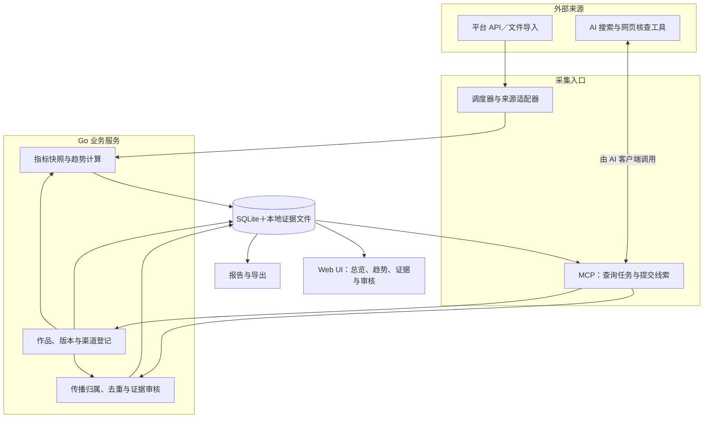
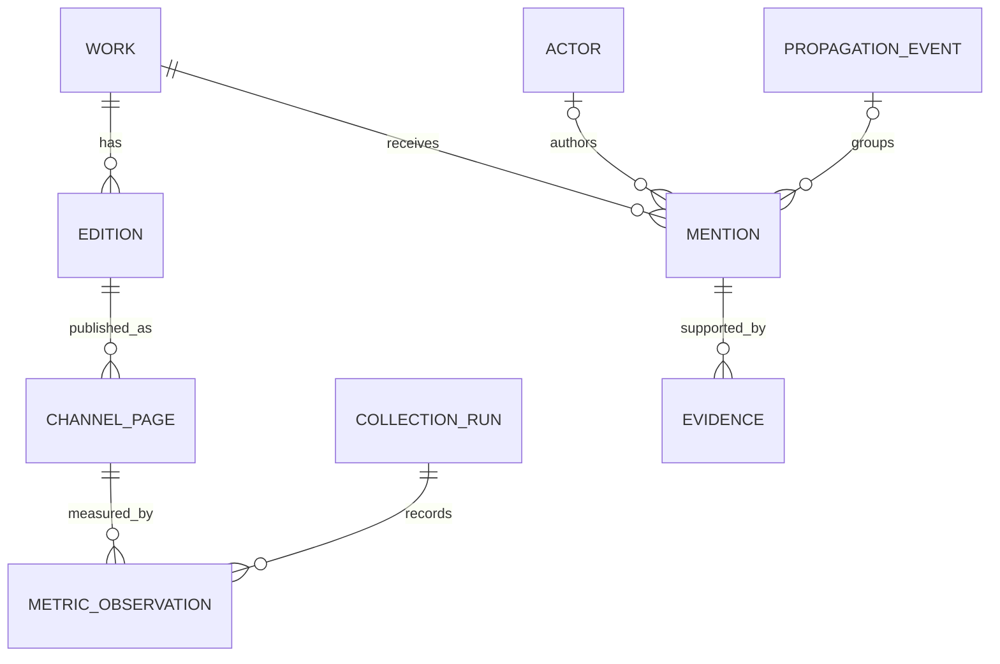

# 开源与内容影响力观测：架构与第一版设计

日期：2026-10-31（北京时间）
状态：基础实现中；已完成能力与待办见 README 和实施计划
技术方向：Go 单服务＋SQLite＋本地 Web UI＋MCP

## 1. 项目目标

持续记录个人公开成果如何被发现、阅读、传播、引用和使用，将过去分散在多次对话中的临时调查，变成可追溯、可更新、可比较的历史。

覆盖开源项目、技术文章、中英文版本及各平台分发页面。所有用户均可配置自己的账号与作品；个人作品和调查记录作为私有配置与历史数据导入，不写死在产品代码里。

核心业务独立实现，通用 SDK、数据库驱动、MCP 和图表组件复用成熟依赖。参考 git-stats 的快照方法与 Mentions United 的来源适配机制。

## 2. 整体架构图

图中 AI 搜索由 ChatGPT 或其他 Agent 客户端编排，客户端同时调用搜索／网页工具与本项目 MCP。MCP 不自动启动模型，也不默认在本地服务中提供搜索引擎。图中的双向关系表示业务协作，具体工具调用由客户端完成。

Web UI、HTTP API 与 MCP 使用同一业务层，统一校验、事务和统计口径。第一版无需微服务、消息队列或向量数据库。

## 3. 两条采集流程

### 3.1 平台指标采集

1. 调度器或用户触发一次来源采集，记录任务与目标。
2. 适配器读取 API 或解析导入文件，保存经敏感字段过滤的原始响应。
3. 将数据归属到账号、来源页面和作品，保存指标定义与覆盖范围。
4. 保存累计快照或更新对应日期的指标；计算有明确区间的变化。
5. 查询层生成趋势，展示成功、部分成功、失败及缺口。

各来源独立执行；重试有上限。同一任务重复提交不得重复计数，权限或网络错误不得被写成指标零值。

### 3.2 AI 发现与证据补充

1. AI 通过 MCP 获取作品、标题、别名、原文和分发 URL，以及此前搜索记录。
2. AI 调用可用的搜索与网页工具，搜索作者、品牌、仓库地址、标题和独特内容片段。
3. 打开候选原页，提交 URL、证据短摘录、对应作品、判断理由与采集时间。
4. 服务完成 URL 规范化、重复检查与归属检查，将候选写入待审核列表。
5. 审核后纳入对应传播统计，关联已有作者与传播事件；再次发现只更新核查时间。
6. 保存搜索引擎、检索词、范围、执行时间和失败原因。未发现结果仅代表该次搜索范围内未发现。

搜索任务支持待处理、执行中、完成、部分完成、失败。领取任务使用租约与幂等键，避免两个客户端重复提交。自动搜索执行器可后续扩展；第一版由 AI 客户端触发即可。

## 4. 业务模块

| 模块 | 职责 | 第一版范围 |
|---|---|---|
| 作品登记 | 项目、文章、系列、中英文版本、别名与旧地址 | 支持手工与结构化文件导入 |
| 渠道登记 | 平台账号、原文页面、分发页面与发布记录 | 保留平台 ID、语言、URL 和 UTM |
| 来源适配器 | 指标采集、文件解析、能力与错误报告 | GitHub 优先；其他来源可先导入 |
| 指标历史 | 原始快照、逐日数据、区间变化与完整性 | 下载、访问、克隆、Star/Fork 等 |
| 传播证据 | 引用、转载、讨论、聚合、实际使用 | AI 提交、审核、归并与重新核验 |
| 流量分类 | 本人、已知自动化、疑似人工、疑似自动化、未知 | 记录规则与依据；不宣称精确真人数 |
| 技术事件 | 域名迁移、发布、推广、故障和修复 | 时间线登记，辅助解释变化 |
| 历史导入 | 旧报告、人工快照、历史调查线索 | 来源可追溯，数字带原始时间范围 |
| 展示与报告 | 总览、作品详情、渠道表现、证据与待办 | Web UI、MCP 查询和 Markdown／CSV 导出 |

## 5. 关键数据模型

| 实体 | 关键字段与含义 |
|---|---|
| Work | 稳定 ID、类型、标题、别名、所属系列；文章与项目统一登记 |
| Edition | 对应作品、语言、版本及主地址；中文与英文可关联同一作品 |
| ChannelPage | 平台、账号、平台 ID、URL、原文／自分发关系、发布时间 |
| CollectionRun | 来源、目标、采集时间、覆盖范围、状态、错误与原始快照路径 |
| MetricObservation | 目标、指标、数值、单位、日期或时间区间、时区、聚合范围、维度、采集来源 |
| Actor | 外部作者或组织；身份关联需要证据，不因显示名相同而强行合并 |
| Mention | 传播页面、对应作品、作者、传播类型、来源方式、生成方式及审核状态 |
| Evidence | 原始 URL、短摘录、内容哈希、采集方式、发现／核验时间、可用状态 |
| PropagationEvent | 将同一引用或采用过程的多条记录归组；保留逐页记录与独立事件数 |
| DiscoveryTask／SearchRun | 目标、检索词、检索范围、任务租约、执行与结果记录 |
| TechnicalEvent | 发布、迁移、推广、故障、修复的时间与关联对象 |
| ReviewLog | 修改前后状态、操作者、理由、时间，支持审计与撤销 |

所有历史表按来源和目标隔离，不能只用“指标＋日期”作为跨仓库主键。原始 API 快照与统计派生结果分开保存，以便修正解析或规则后重新计算。

## 6. 统计口径与证据规则

- 下载、克隆、搜索点击、平台阅读、访客标识与已确认用户使用分别展示。
- Release 按稳定 asset ID 留快照；首次记录是基线。新发现但早已存在的文件不将历史累计下载全部记作本期新增。删除、替换和计数下降保留异常说明。
- GitHub 逐日流量按仓库与日期更新，重叠窗口不重复相加；保存修订历史，不假定源数据永远只增不减。
- 去重访客不得跨天、跨平台或跨来源简单相加。窗口级去重总数保存为独立观测值。
- 搜索属性级和页面级指标保留各自范围，CTR 的分子与分母必须一致。
- 新旧域名分别保存，并关联迁移事件；统一作品归属不等于可以合并去重人数。
- 所有指标保留来源时区、完整时间范围与最近成功采集时间，部分日期不与完整周期直接比较。
- 来源名称、地区、无 Referer 或零自定义事件不能单独证明真人／机器人身份。
- 传播类型、来源方式、内容生成方式、核验状态分别建模；转载数量不等于独立引用者数量。
- 同一作者的 DEV、LinkedIn 和 GitHub 记录可以构成多条证据，但不自动算作多个独立引用者。
- 认同方法、提出 Issue、提交修复和修复合入分别记录，不能由前一阶段推导后一阶段已经发生。
- 原始观测、分类结果和分析推断分开保存。主观知名度评分与成功概率不进入事实指标。
- 证据仅保存必要的短摘录、页面元信息和核查记录；不默认归档第三方文章全文。

## 7. 历史调查如何接入

历史检索覆盖 2026 年 9 月 17–18 日、9 月 28–30 日、10 月 12 日、17 日、20 日、22 日、27 日及 31 日的相关记录。不是完整对话库的穷尽审计；历史调查中的外部网页尚未在本次重新逐页核验。

| 历史调查方向 | 已有方法／案例 | 项目中的承接方式 |
|---|---|---|
| 搜索可见性 | 品牌词、技术长尾、中英文、不同搜索引擎 | SearchRun 记录检索条件与实际结果 |
| 搜索获客 | GSC 新旧域名、展示、点击、CTR、排名 | 属性与页面级观测分开存储 |
| 分发表现 | 博客园阅读／评论／推荐，DEV／Medium／Hashnode 渠道覆盖 | ChannelPage 与指标快照 |
| 分发回流 | 平台来源、落地页、自行管理的 UTM | 发布事件与回流观测关联；不据此认定独立读者 |
| 真实受众判断 | Umami 原始数据、可疑会话、本人测试混入 | 原始值保留，分类规则和审核历史另存 |
| 独立引用与采用 | 同一作者在文章与 Issue 中引用并采用方法的历史线索 | 建立关联线索组，导入后标为待原页复核 |
| 转载与自动传播 | CSDN、技术栈、RSS、二次整理、AI 生成引用等历史线索 | 保存类别、来源与证据，账号数／页面数／作品数分别展示 |
| 技术健康 | 索引、canonical、迁移、403／404、EdgeOne | 登记技术事件；后续适配器按需补充 |
| 开源获取 | Release、克隆、访问、Star/Fork、外部反馈 | GitHub 适配器与长期快照 |

历史基线保存在用户运行数据中；本仓库不提交个人指标、原始会话、私有报告链接或已识别的第三方案例。开发使用合成作品和统计数据。

导入时分别记录 observed_at（原数据时间）、discovered_at（发现时间）、imported_at（导入时间）、verified_at（原页核验时间）。历史助手报告标为 secondary_report；读取原始 API 或原网页后再增加对应证据，不自动将历史表述升级为原页已核验。

## 8. MCP 与 HTTP 业务接口

| 接口 | 用途 |
|---|---|
| list_works / get_work / upsert_work | 查询与登记作品、语言版本及渠道页面 |
| list_discovery_tasks / claim_discovery_task | 查询与领取搜索任务 |
| record_search_run / complete_discovery_task | 保存检索范围和任务执行结果 |
| submit_mention / list_mentions | 幂等提交与查询传播线索 |
| review_mention / link_propagation_event | 审核、关联证据与传播事件 |
| collect_source / get_collection_status | 触发采集、查询完成状态与缺口 |
| import_history | 预览并导入结构化历史记录，返回逐条结果 |
| get_trends / generate_report | 查询趋势、覆盖范围和证据支持的报告 |

写入接口校验目标与字段，使用 request_id 保证幂等；审核更新带版本检查并写入 ReviewLog。AI 提交内容默认是候选，审核状态需由明确动作改变。MCP 工具描述标明读写性质，不提供任意 SQL 或任意文件路径写入接口。

## 9. Web UI 页面

| 页面 | 展示内容 |
|---|---|
| 总览 | 各来源趋势、最近新增已核验证据、来源健康与数据缺口 |
| 作品详情 | 中英文及渠道关系、指标时间线、传播记录与采用进展 |
| 渠道表现 | 各平台指标、UTM 回流、发布前后变化 |
| 传播证据 | 转载、引用、聚合、互动、使用案例及原始链接 |
| 待审核 | 新线索、重复候选、身份关联歧义、已失效证据 |
| 搜索与采集任务 | 最近执行、覆盖范围、失败与重试 |
| 设置与导入 | 来源配置、私有凭据、作品登记、历史导入与导出 |

无数据时展示未采集、无权限、采集失败或该范围内未发现。每张图表显示时间范围、来源和更新时间。

## 10. 复用决策与运行边界

| 候选 | 使用方式 |
|---|---|
| git-stats | 参考快照、asset 增量、原始数据与派生库设计；核心数据模型自行实现 |
| Mentions United | 参考 Provider 和统一互动结构；按本项目持久化与审核需求实现 |
| Webmention.io | 作为可选通知／查询来源，不当作全网转载发现服务 |
| OSSInsight／GrimoireLab | 参考社区分析与多来源方法，第一版不部署完整平台 |
| GitHub SDK／SQLite／MCP／图表组件 | 经版本和许可证检查后作为依赖复用 |

产品代码、测试夹具与个人运行数据分开；开源仓库只包含脱敏示例。令牌、Cookie 和账号配置不进入数据库原始响应、日志、导出与公开仓库。本地默认监听回环地址；对外 MCP 入口配置鉴权，本地 Web UI 使用进程内独立的 HttpOnly 同源会话；MCP 与程序接口保留 Bearer 鉴权。

数据库使用迁移版本；备份使用 SQLite 一致性备份机制或停写后导出，不能仅复制可能处于 WAL 写入中的主文件。证据文件与数据库建立清单对应，支持恢复检查。

## 11. 第一版实施与验收

1. 建立 Go 服务、SQLite 迁移、业务层、作品与渠道登记。
2. 实现 GitHub 指标采集、原始快照、逐日去重与下载增量。
3. 实现历史结构化导入、传播证据、审核与事件归并。
4. 提供 MCP 查询、发现任务、线索提交、审核与报告接口。
5. 完成 Web UI 总览、作品详情、趋势、证据与待审核列表。
6. 导入个人作品和历史线索，采集首份真实基线，核查一次搜索→提交→审核→报告流程。

验收重点：重复采集不重计数；新增旧 asset 不制造本期下载；失败不变成零；跨仓库互不污染；原始与去重口径正确；同一引用多页面可归组；历史报告可追溯；未审核线索不进入已确认统计；凭据不出现在日志或导出中。

后续依次补充 Umami、Search Console、分发平台统计、Webmention，以及可选的自动 AI 搜索执行器。各来源能力与接口权限在接入时实际验证，不在架构稿中承诺已支持。

## 12. 参考项目

- git-stats：https://github.com/dejo1307/git-stats
- git-stats 数据库结构：https://github.com/dejo1307/git-stats/blob/main/internal/store/store.go
- Mentions United：https://github.com/kristofzerbe/Mentions-United
- Webmention.io：https://github.com/aaronpk/webmention.io
- OSSInsight：https://github.com/pingcap/ossinsight
- GrimoireLab：https://github.com/chaoss/grimoirelab

本文件是设计与需求整理。参考不等于已复制源码；实际引入依赖或代码时记录来源版本并保留所需版权与许可声明。
