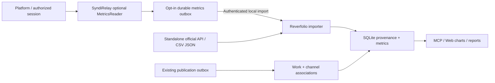

# Cross-platform creator impact: account followers, article reads and engagement

> **Update (v0.9.0): historical design only; superseded by direct official APIs.** Reverfolio independently connects to authorized platform APIs; SyndiRelay is optional for public publication-link handoff only. Do **not** implement the metrics outbox, schema-v6 proposal, browser-session scraping or publisher-runtime dependency described below. DEV.to account/publication metrics, SQLite schema v7, UI and MCP are implemented. Hashnode and other platform adapters are still pending official API verification. See the [current API-only implementation guide](platform-api.md).

**Status: proposed, not yet implemented** (2026-11-01). This extends [P6 in the implementation plan](implementation-plan.md) without changing the existing GitHub, Umami, Google Search Console or Bing collectors. Full design and contracts: [中文设计方案](social-impact-architecture.zh-CN.md).

## Ownership

- **Reverfolio** owns persistent work and account identity, article-channel bindings, metric observations, provenance, data quality, history, charts, MCP tools, reporting and user-supplied CSV/JSON imports.
- **SyndiRelay** optionally provides **read-only** platform measurements using its existing publishing-side auth/session capabilities. Its current four-method `publisher.Adapter` only handles authentication/drafts/publication; metric reading is not implemented. Add an optional `MetricsReader` interface and explicit per-platform capability flags without making every publisher implement the method.
- The existing private, loopback-only SyndiRelay → Reverfolio outbox sends confirmed public publication metadata. Add a **separate opt-in metrics event stream** to the same durable at-least-once delivery pattern, authenticated on the receiver and idempotent on `source_id + batch_id`.
- No shared SQLite, user cookies, browser sessions, credentials or content bodies. Either application remains runnable without the other. Standalone Reverfolio users may supply exports or independently authorized providers.

## Data model (proposed schema v6)

| Entity | Purpose |
|---|---|
| `owned_platform_accounts` | Platform + stable remote account ID, verified profile URL, optional multiple accounts per platform. |
| `platform_publications` | Existing `channel_pages.id` + account + remote article ID. Never count drafts as published. |
| `platform_collection_runs` | Per-provider capture time, status, method, errors and coverage, no credential bytes. |
| `platform_metric_points` | Explicit account/publication scope, metric, value, unit, lifetime/interval semantics, source method, observed and period timestamps, idempotency key. |
| `platform_metric_definitions` | Advertised semantics and support per provider. Unsupported is not zero. |

**Account:** followers (lifetime snapshot), new followers (if a provider reports an explicit interval).

**Publication:** views, reads, reactions, comments, bookmarks, shares where individually supported; names do not imply consistent cross-platform definitions. Retain native labels and their precise meaning.

**Never invent unique cross-platform people**. Followers across platforms are subscriptions, not unique persons; pageviews, reads, visits and GitHub downloads are not interchangeable. The first observed cumulative counter is a baseline, never a period increase. Missing, unsupported, stale, unauthorized, or rate-limited reads must retain distinct statuses. Legitimate counter decreases (unfollows, deletion, provider methodology changes) are retained and flagged rather than silently discarded or clamped to zero. Collect aggregate follower metrics, not follower identities. Each displayed value should expose its platform, owner, work/channel, source, timestamp, timezone and measurement period.

## Flow

Security: only explicitly authorized read-only endpoints, official APIs before permitted browser read-only flows, no token/cookie relay, no bypass of site access controls. Existing origin-only status endpoints must not be reused for sensitive service-to-service transfers; enforce auth, loopback binding, rate limits and input caps.

## Priority & gates

1. **DEV.to** (official [Forem API v1](https://developers.forem.com/api/v1) includes analytics totals, historical data and follower engagement): implement receiver schema/import + official API reader and its own metrics outbox, then a real read-only, consented end-to-end test.
2. **Medium** ([Statistics](https://help.medium.com/hc/en-us/articles/215108608-Stats) include views, reads and followers, but [no new API integration tokens](https://help.medium.com/hc/en-us/articles/213480228-API-Importing)), **Juejin**, **Zhihu**, **Toutiao**: prove each permitted read-only metric route and auth before implementing. Unsupported sources remain explicit.
3. **Hashnode** ([GraphQL API](https://docs.hashnode.com/quickstart/introduction), available metric fields must be verified), CSDN, CNBlogs, 51CTO, SegmentFault, OSChina: add separately only when reliable read-only access and semantics are established.

**Five PR slices:** (A) accounts/metrics schema, receiver + MCP, (B) SyndiRelay DEV official API + metrics outbox, (C) dashboard and extension charts + integration tests, (D) second-wave authorized sources, (E) remaining adapters and historical imports.

Acceptance requires isolated-account and publication attribution, correct lifetime/interval math, idempotent retries, auth failures and missing data handling, no disruption when SyndiRelay is unavailable, bilingual docs, three-OS CI, privacy review and only synthetic data committed to the repository.
