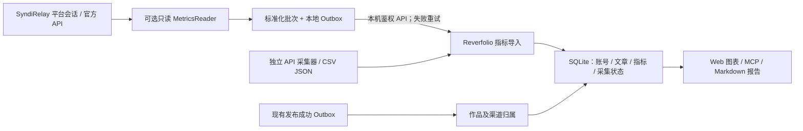

# 跨平台创作影响力：账号粉丝、文章阅读与互动指标

状态：**设计方案，尚未实现**（2026-11-01）。本设计延续 [实施计划 P6](implementation-plan.md)，不改变现有 GitHub、Umami、GSC、Bing 采集方式。

## 结论与边界

- **Reverfolio（观察者）**：拥有作品、平台账号、文章绑定、统一指标、历史快照、来源审计、定时趋势、Web UI、MCP 和报告。
- **SyndiRelay（原分发工具，发布者）**：拥有平台认证与发布适配器；可选新增**只读统计能力**，通过已有本地可靠 Outbox 向 Reverfolio 交付标准化指标。它不保存第二份 Reverfolio 统计数据库，不画统计图，不向 ChatGPT 输出浏览器会话。
- **其他用户无须安装 SyndiRelay**：可手动导入 CSV/JSON，之后可选安装独立的官方 API 采集适配器。没有 SyndiRelay 时现有观测功能完全可用。
- **不直接共享 SQLite、浏览器 Cookie、API Key、TOML 或私有报告**。双方只交换授权采集的指标值、公开链接、平台账号标识、观测时间与状态，且由用户显式启用。

代码核对：SyndiRelay 的 `publisher/types.go` 当前 `Adapter` 只包括 `CheckAuth`／`CreateDraft`／`UpdateDraft`／`PublishDraft`，`platform/capabilities.go` 只有发布相关能力；`bridge/impact.go` 已有仅限 loopback 的配置、只传公开作品元数据的 Outbox、请求幂等键与失败重试。**没有通用粉丝/阅读统计读取接口**。

Reverfolio 的 `channel_pages` 当前只包含作品、平台、语言、URL；`HistoricalObservation` 只以作品为主体，不能直接正确存储「某个平台账号的粉丝数」。因此需要独立的账号与指标模型，不把粉丝数硬塞进某篇文章的历史记录。

## 数据流



已有发布 Outbox 继续只同步**确认发布的公开页面**；新增 Metrics Outbox 为**独立订阅开关和事件类型**，不复用发布状态，不使发布操作等待统计采集。采用「至少一次投递 + 接收端幂等」，重复采集不得制造增长量。

## 统一领域模型（建议新增 schema v6）

| 实体 | 关键标识 / 职责 |
|---|---|
| `owned_platform_accounts` | `platform + remote_account_id`（没有官方 ID 时使用用户核对的唯一 profile URL）；handle、启用状态与所有权确认；一个平台可配置多个账号 |
| `platform_publications` | `channel_pages.id + account_id + remote_post_id`；必须确认属于哪篇作品；草稿不能当成已发布文章计数 |
| `platform_collection_runs` | provider、认证方式、采集时刻、状态、错误码、覆盖范围、成功数量；不保留密钥和原始 Cookie |
| `platform_metric_points` | 账号或文章 scope、metric、value、unit、measurement_kind、observed_at、period_start/end、timezone、source_method、collection_run、幂等键 |
| `platform_metric_definitions` | 每平台每指标的可用性、单位、累计/区间属性及来源说明，避免任意字符串混用 |

指标至少区分：

- **账号级**：`followers`（当前关注关系数快照）、`new_followers`（平台明确提供的时间段新增）；**不同平台合计只能称「关注关系之和」，绝非唯一粉丝人数**。
- **文章级**：`views`（浏览事件）、`reads`（按平台口径达标的阅读）、`reactions`、`comments`、`bookmarks`、`shares`；不同平台并非每项都提供。
- **站点级**：已有 GSC 点击/曝光、Umami 访问、Bing 数据留在当前 provider 模型；不迁移、不双重计数。
- **开源项目级**：GitHub Stars/Forks、Traffic、Release downloads 仍为独立指标，不冒充使用人数。

统一批次示意（虚构数据，不是平台采集结果）：

```json
{
  "schema_version": 1,
  "source_id": "syndirelay",
  "batch_id": "stable-idempotency-key",
  "observed_at": "2026-11-01T00:00:00Z",
  "observations": [
    {
      "platform": "devto",
      "scope": "account",
      "remote_account_id": "example-user",
      "profile_url": "https://dev.to/example-user",
      "metric": "followers",
      "value": 100,
      "unit": "subscriptions",
      "measurement_kind": "cumulative"
    },
    {
      "platform": "devto",
      "scope": "publication",
      "remote_post_id": "example-123",
      "published_url": "https://dev.to/example-user/example-123",
      "metric": "views",
      "value": 700,
      "unit": "views",
      "measurement_kind": "lifetime"
    }
  ]
}
```

入库前按平台账号 ID／远端文章 ID 与作品绑定校验；对同 URL 不同作品、重复远端 ID、数值负数、单位错误、未知时间窗返回冲突或记录异常，绝不自动合并未知账号。累计计数可能因取消关注、删稿或平台口径调整而下降：保留真实回退观测并提示异常，不擅自删除或强制改为递增。不知道 `value` 是 0 还是缺失时，必须返回 missing/blocked，而不是写 0。首次采到累计值仅是**基线**；只有连续有效观测才能计算增长，原始平台提供区间新增时保存其具体时间窗。

## 如何利用已有 SyndiRelay，而不制造强依赖

1. 在 `publisher` 旁引入**可选**的 `MetricsReader`／`MetricsCapabilities`。不要把读取指标塞入所有发布 Adapter 的必选接口，也不要重写文章发布、上传或 Cookie 获取。
2. 在已授权的 publisher/session 层，用相同账号会话执行**官方 API 优先、经许可的浏览器只读统计次之**。不要导出 Cookie 给 Reverfolio，不自动创建 Token，不调用写入型平台接口。
3. 新增仅本机使用的统计采集任务和独立 Metrics Outbox。仅保存明确允许的字段，提供单平台停用、冷却与退避；失败不影响发布。
4. 利用已部署的 `bridge/impact.go` 本地安全交接惯例，向 Reverfolio 新的 `import_platform_metrics` 行为提交批次；双方独立安装/卸载，停用后保留已观测历史。
5. Reverfolio 以自身 SQLite 为唯一指标数据库，统一 MCP、UI、CSV 和报告。没有发布器的用户可以仅导入指标，或使用后续独立官方 API 适配器。

**安全要求**：现有允许浏览器扩展读取运行状态的接口不可直接当作服务间统计接口；新增写入 API 必须校验 Bearer/来源，限制 loopback、内容长度、超时、目标平台域名和频率。只读行为也不能被未授权请求任意触发。避免脚本执行、HTML 注入、浏览器焦点抢占、跨站 Cookie 访问及反验证码绕过。

## 平台能力：按验证情况逐步启用

| 波次 | 平台 | 入口与需要验证的指标 |
|---|---|---|
| A / MVP | DEV.to（Forem） | 官方 API v1 具备 analytics totals / historical / follower engagement；以已授权 API Key 获取账号与文章统计，精确映射远端 ID、生命周期累计与区间数据；仅拉取必要的聚合数字，不为了算粉丝数批量读取粉丝身份列表 |
| B | Medium | 官方 Stats UI 有 presentations / views / reads / followers，且官方不再签发新 API Token；先验证合法只读路径，不得把 views 与 reads 混为同一指标 |
| B | 掘金、知乎、头条 | 有分发侧会话基础，但统计入口和可用范围需真实只读验证；无稳定/许可入口则明确 unsupported 或手动导入 |
| C | Hashnode | 有官方 GraphQL；文章/用户指标字段与当前授权范围须先做 schema/权限验证，不能推断存在 |
| C | CSDN、博客园、51CTO、思否、开源中国 | 逐个适配；优先已公开、官方、可授权的只读统计，不为了全覆盖而抓取脆弱的私有页面 |

参考：[Forem API v1](https://developers.forem.com/api/v1)、[Medium Stats](https://help.medium.com/hc/en-us/articles/215108608-Stats)、[Medium API / Importing](https://help.medium.com/hc/en-us/articles/213480228-API-Importing)、[Hashnode GraphQL](https://docs.hashnode.com/quickstart/introduction)。

## UI / MCP

- **平台账号**：各平台头像/名称/主页、粉丝量当前快照、日/周/月变化、最近成功采集、授权与缺数状态。
- **文章表现**：按同一 `work_id` 查看站点原文、英文镜像及每个外部分发链接的浏览/阅读/互动；支持趋势、排序和导出 PNG/SVG/CSV。
- **来源可追溯**：每个数字可展开 `platform / account / publication / source_method / observed_at / period / timezone / status`；失效数据不伪装为最新。
- **MCP**：新增 `list_platform_accounts`、`get_platform_metrics`、`import_platform_metrics`、`get_engagement_summary`（命名可在实现时统一）；大批量导入要有限流、幂等、数据校验、原始证据索引。
- **默认不制造「总独立读者」或不透明的影响力分数**。若显示跨平台加总，应称「平台报告阅读/浏览事件合计」，附口径与平台覆盖率，不能推断去重人数。

## 实施 PR 顺序与验收

1. **PR-A：Reverfolio schema + 接收端**。新增账号/文章映射、统一指标与采集状态、版本迁移和备份；支持模拟批次、CSV/JSON 导入、MCP 只读/导入。以全新数据库和含历史数据的数据库完成迁移与回滚测试。
2. **PR-B：SyndiRelay DEV.to Reader**。只扩展可选读指标接口，官方 API fixture 覆盖账号及文章；独立 Metrics Outbox 发送到 Reverfolio，验证未启用/接收端离线/重复投递/401/429；不给发布行为加同步依赖。
3. **PR-C：Reverfolio 图表**。平台粉丝趋势、文章按平台排行，缺数与采集时间显示；Web 和 Chromium 扩展一致，MCP 返回相同数据。完成 DEV.to 真实授权只读端到端验收。
4. **PR-D：第二波平台**。逐个平台确认 Medium/掘金/知乎/头条的统计访问条件，先通过官方或授权只读入口测试，再逐个实现；遇到不支持的指标明确标为 unavailable。
5. **PR-E：长期扩展**。Hashnode 等平台、历史 CSV 导入、技术事件时间线，以及与 AI 搜索传播证据并列展示。均需独立开关、指标口径审计和采集失败重试。

验收门槛：全部统计记录都有真实来源、账号/文章唯一归属及时间；同一批次重试无重复；跨平台不可比口径不相加冒充独立人；无授权/服务未开时现有 Reverfolio 核心流程正常；中英文文档、Go race/vet、三系统 CI、安全与开源检查通过。

## 不在本轮做

不将全部 11 个平台统计一次性宣布支持；不把 SyndiRelay 数据库/适配器复制进 Reverfolio；不自动绑定同昵称跨平台账号；不自动授权采集非公开账号；不绕过登录/访问控制；不推断软件安装人数、实际读者人数或付费转化。
